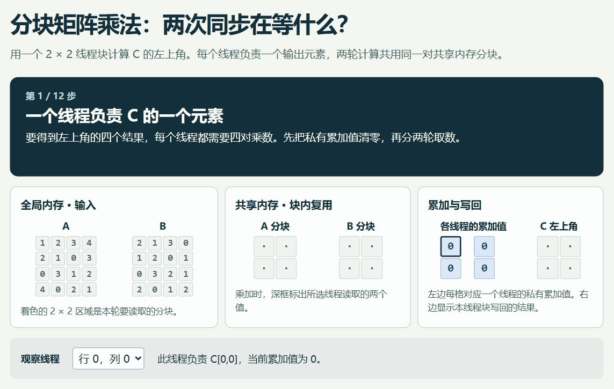

# Book to Consultant · Your lightweight personal study advisor

[简体中文](README.md) · **English**

Give your agent a technical textbook as a PDF. It reads the book section by section and writes notes in your Obsidian vault, with links back to the pages they came from. You can jump straight to a question about Chapter 5, open the author's diagram or code, or say **“Let me try explaining it”** and talk through the idea with your study advisor.

## Ask Codex to install the skill

Paste this into a Codex chat that has access to your local files:

```text
Please install the book-to-tutor skill from https://github.com/PythonSouls/Book_to_Consultant.
Copy the entire book-to-tutor subdirectory into my personal skills directory. Install the dependencies from its requirements.txt using the same Python environment you will use to run the skill.
Then verify that Codex can find SKILL.md and that Python can import pymupdf. Tell me how to start reading my first book.
```

Attach your textbook PDF to the chat and send:

```text
Use $book-to-tutor to read this whole book into my Obsidian vault. When you're done, give me a clickable link to the book's home note.
```

On first use, your study advisor asks where your Obsidian vault is. It writes notes and teaches in Chinese by default, preserving English terminology, formulas, and code identifiers.

## A question you might ask while reading

Figure 5.9 in the fourth edition of *Programming Massively Parallel Processors* uses tiled matrix multiplication to explain shared memory. Two lines in the loop are easy to puzzle over:

> **You** — Each iteration calls `__syncthreads()` twice. If the first barrier waits for everyone to finish loading the tile, why do we need the second?
>
> **Study advisor** — The first barrier makes sure the whole block has **loaded** the tile before any thread reads values its neighbors brought in. The second makes sure the whole block has **finished using** that tile. Otherwise, a faster thread could overwrite a value with data from the next tile while another thread still needs the old value.



The demo breaks two iterations into 12 steps. Watch it all the way through, or pause and switch threads to follow a single output value as it accumulates. Download the HTML file and open it in a browser to play it offline. The controls and captions are in Chinese. [Get the interactive demo](book-to-tutor/assets/tiled-matmul.html)

> **You** — Let me try explaining it. First we wait for everyone to finish loading. Then we wait for everyone to finish reading.
>
> **Study advisor** — Suppose we remove the second barrier. One thread starts loading the next tile while another is still doing its last multiply-add. Which tile might that second thread read from?

You decide when to explain an idea back to your study advisor. It lets you finish, then changes one condition and asks what follows. If a sentence captures what finally clicked, you choose whether to save your exact words beside the figure.

## How a section of the book helps you at work

Imagine a recommendation service whose batch scoring slows down at peak traffic. You've just read about matrix tiling. How would you decide whether to change the implementation?

[](docs/field-notes.md)

The sketch follows six questions you can use with your own workload:

1. **What is happening in production?** Replay representative requests and measure end-to-end latency under load.
2. **Which part can this section help with?** Find out how much time scoring spends in the matrix multiplication kernel, then investigate whether threads repeatedly load the same inputs.
3. **How does the mechanism work?** Follow one tile from global memory into shared memory and watch several threads reuse it.
4. **Which conditions matter?** Identify when every thread in the block must finish loading and when it must finish reading.
5. **Which example makes it click?** Trace one output element through two iterations of a small matrix multiplication.
6. **What can you deliver?** Compare numerical results, memory traffic, kernel time, and request latency. Use the measurements to recommend keeping or replacing the current implementation.

This is an illustrative production scenario. Repeated reads are a hypothesis to test on the actual workload. [Explore the illustrated field notes (Chinese)](docs/field-notes.md)

## What stays in your Obsidian vault

- **A book you can open in the middle.** The book's home note links to the PDF and chapter index. Each section cites its pages, even when a code listing and its caption fall on different pages. An interrupted import can resume from pending pages, and unclear passages stay on the review list.
- **Concept notes that grow across books.** When another author explains shared memory, the agent can add the new example and its assumptions to your existing note, with a separate source for each book. If a proposed update conflicts with a passage you edited, your wording stays in place for review.
- **The sentence that made sense to you.** With your permission, your study advisor saves your own explanation alongside its source. When you come back later, you can recover both the thought and the material that prompted it.

## Feedback and suggestions

Which explanation helped a passage click? Where did you get stuck? Is there another way you'd like your study advisor to explain an idea? We'd love to hear from you. [Share feedback on GitHub Issues](https://github.com/PythonSouls/Book_to_Consultant/issues/new)

[Skill instructions (Chinese)](book-to-tutor/SKILL.md) · [Importing books and combining notes (Chinese)](book-to-tutor/references/import.md) · [Teaching and animations (Chinese)](book-to-tutor/references/teach.md) · [MIT license](LICENSE)
