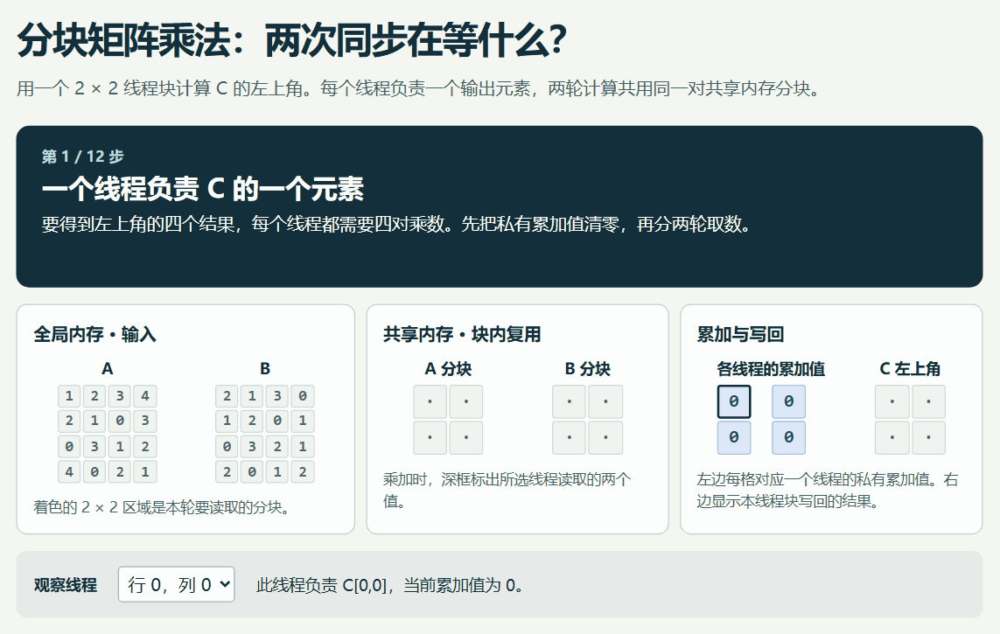
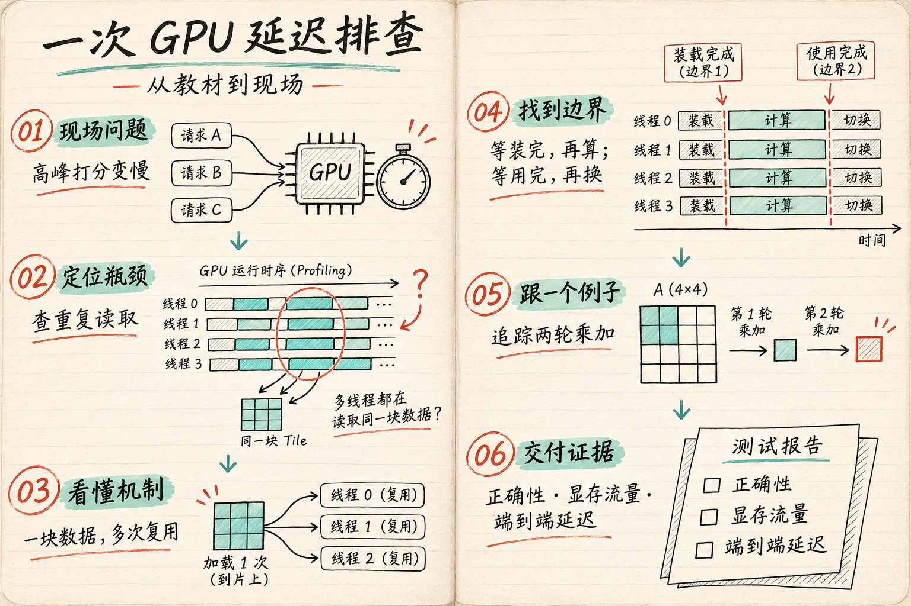

# Book to Consultant · 您的轻量级私人学习顾问

**简体中文** · [English](README.en.md)

把一本技术教材交给 agent，它会逐节读完整本 PDF，在你的 Obsidian 库里写下带出处的中文笔记。之后你可以直接从第五章问起，点回作者的图和代码，也可以说一句 **“我来讲讲”**，让导师听你把原理讲明白。

## 让 Codex 帮你安装

把下面这段话直接发给能访问本地文件的 Codex：

```text
请帮我安装 https://github.com/PythonSouls/Book_to_Consultant 中的 book-to-tutor skill。
把 book-to-tutor 子目录完整安装到我的个人技能目录，用运行这个 skill 的 Python 安装其中 requirements.txt 的依赖。
完成后，请确认 Codex 能找到 SKILL.md、Python 能导入 pymupdf，并告诉我怎样开始读第一本书。
```

装好后，在聊天里附上自己的教材 PDF，发送：

```text
用 $book-to-tutor 把这本书完整读入我的 Obsidian 库。完成后给我能直接点开的全书入口。
```

第一次使用时，导师会问你的 Obsidian 库文件夹在哪里。默认用中文讲解，保留英文术语、公式和代码原名。

## 一次真实的读书问题

《Programming Massively Parallel Processors》第 4 版用一段分块矩阵乘法代码讲共享内存。读到图 5.9，你可能会停在这里：

> **你**　每轮都有两次 `__syncthreads()`。第一次已经等大家把数据搬完了，为什么还要等第二次？
>
> **导师**　第一次等全块把这一轮的数据**装进来**，线程才能读取同伴搬来的数。第二次等全块把这些数**用完**。如果快的线程提前装入下一块，就可能覆盖慢的线程还要读取的值。



这段原创演示把两轮计算拆成 12 步。你可以先完整看一遍，也可以暂停、切换线程，观察一个输出值怎样累加。下载 HTML 后用浏览器打开即可离线播放。[获取交互演示](book-to-tutor/assets/tiled-matmul.html)

> **你**　我来讲讲。第一次等大家搬完，第二次等大家用完。
>
> **导师**　把第二次等待拿掉。假设一个线程已经开始搬下一块，另一个还在做本轮最后一次乘加，它可能读到哪个分块的值？

回讲由你发起。导师先听完，再挑一个条件变化追问。哪句话值得留在图 5.9 的笔记旁边，也由你决定。

## 每节笔记怎样落到实际工作

高峰期推荐打分变慢了。学完矩阵分块这一节，你怎样判断它能不能帮上忙？这页手绘笔记从一次请求出发，最后回到团队需要的交付物：一份能说明应当保留还是更换实现的测量报告。

[](docs/field-notes.md)

这是导师自拟的生产场景。图中的“重复读取”是待验证的假设，结论取决于实际测量。[展开手绘页，逐问查看排查思路](docs/field-notes.md)

## 你的 Obsidian 库里会留下什么

- **一本可以从中间翻开的书。** 书籍首页连接原书和章节索引，每节笔记保留页码。遇到跨页的代码图，能把图体和下一页的图注放在一起看。中断后可以从待处理页继续，读不清的地方会留在清单里。
- **一篇能随着阅读改进的概念笔记。** 第二本书也讲“共享内存”时，agent 会在已有解释上补充例子和适用条件，保留各书出处。你手写过的段落遇到更新冲突时，会留给你审阅。
- **你自己讲通的那句话。** 只有你同意保存的原话才会写入。以后翻回来，能看到当时让你想通的解释，也能点回它对应的材料。

## 欢迎反馈与建议

欢迎每一位使用者分享意见和建议！哪一段讲解帮你读懂了书，哪一步用起来不顺手，或者你希望导师换一种方式教你，都可以告诉我们。[在 GitHub Issues 留下反馈](https://github.com/PythonSouls/Book_to_Consultant/issues/new)

[技能入口](book-to-tutor/SKILL.md) · [整书导入与多书融合](book-to-tutor/references/import.md) · [教学与动画](book-to-tutor/references/teach.md) · [MIT 许可证](LICENSE)
