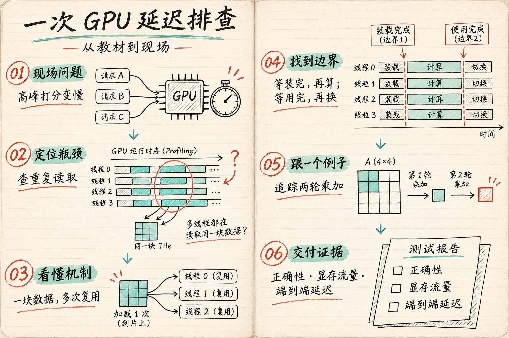

# 一次 GPU 延迟排查

高峰期，推荐服务的批量打分开始变慢。你刚学完分块矩阵乘法，这项优化值得放进服务吗？用六个问题把书里的机制和现场要做的判断接起来。

## 左页 · 从现场找到要读的那一节

1. **谁遇到了什么问题？** 先拿一组有代表性的请求回放，记录输入尺寸、负载和端到端延迟。沿请求链查看时间花在排队、数据传输，还是 GPU 计算。图里用红笔圈出的是要查的位置。
2. **本节能解决哪一部分？** 如果矩阵乘法 kernel 占了可观的时间，再查看它的访存行为。多个线程读取同一批输入，是一个可以用性能分析工具检验的假设。
3. **机制怎样运作？** 看左下角的绿色分块。同一线程块的线程协作把它从全局内存搬进共享内存（shared memory），各自计算输出时就能复用已经搬来的值。

## 右页 · 把书里的解释变成一个工程判断

4. **哪些条件重要？** 沿线程时间线读两道红线。第一道等全块装完本轮数据，第二道等全块读完旧值。若下一轮提早写入同一片共享内存，仍在计算的线程可能读到下一块的值。
5. **哪个例子能看懂？** 在 4×4 矩阵里跟踪一个输出元素。一个线程先用前两对输入做乘加，再用后两对；留意两轮之间，输入分块被替换，线程自己的累加值仍然保留。下载 HTML 后可以逐步看，也可以切换线程。[打开分块矩阵乘法演示文件](../book-to-tutor/assets/tiled-matmul.html)
6. **现场能交付什么？** 在相同的代表性输入、硬件和精度下，对照原实现与分块实现。报告先核对数值正确性，再列显存流量、kernel 耗时和端到端延迟。假如流量下降了而请求延迟没改善，这也是决定是否采用新实现的依据。

这是导师自拟的生产场景，插图中的时间线为示意。实际项目中应填入自己的测量条件和结果。[返回项目首页](../README.md)
